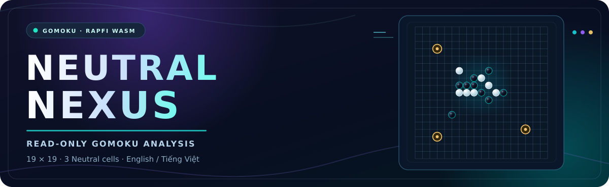

<div align="center">
  

  <h3>See the position. Explore the possibilities. Stay in control.</h3>
  <p>A local, read-only analysis companion for supported <strong>19 × 19 Gomoku boards with 3 Neutral cells</strong>.</p>

  <p>
    
    
    
    
    
  </p>

  <p><strong>English</strong> · <a href="README.vi.md">Tiếng Việt</a></p>
  <p>
    <a href="#quick-start">Quick start</a> ·
    <a href="#features">Features</a> ·
    <a href="#compatibility">Compatibility</a> ·
    <a href="#analysis-modes">Analysis modes</a> ·
    <a href="#development">Development</a>
  </p>
</div>

---

> [!IMPORTANT]
> **An assistant, not an autoplayer.** Neutral Nexus reads supported board positions and visualizes candidate moves. It **never clicks the board, submits moves, or opens game-server sockets**. Suggestions are alternative *first moves*, not an automatic move sequence.

<a id="features"></a>
## ✨ What you get

| | |
| :--- | :--- |
| 🧠 **Local Rapfi engine**<br>Rapfi runs through WASM in a Web Worker. Its model and hash table remain available during the active analysis session. | ⭐ **Ranked move candidates**<br>A star marks the top option; `2`, `3`, … indicate alternative first moves on the board. |
| 📊 **Live search insights**<br>Evaluation, depth, selective depth, searched nodes, speed, elapsed time, and ranked MultiPV lines. | 🎛️ **Flexible settings**<br>Fast / Slow / Analysis / Custom, handicap, 3 bundled models, candidate range, 32–256 MB hash, and marker styles. |
| 🪟 **Session-friendly workflow**<br>Pause/resume, a detached analysis window, position copying, and an evaluation history of positions actually analyzed. | 🌐 **English + Vietnamese**<br>Switch languages instantly; the preference is synchronized and remembered. |

<div align="center">
  <sub>19 × 19 board &nbsp; • &nbsp; 3 permanent Neutral cells &nbsp; • &nbsp; Analysis stays local &nbsp; • &nbsp; No automated play</sub>
</div>

<a id="quick-start"></a>
## 🚀 Quick start

**No Node.js is needed to run the extension.**

1. [Download this repository as ZIP](https://github.com/imnwngr/gomoku-neutral-assistant/archive/refs/heads/main.zip) or clone it, then extract it if needed.
2. Open `chrome://extensions` in Chrome or another supported Chromium browser.
3. Enable **Developer mode** → **Load unpacked** → select the folder that contains `manifest.json`.
4. Reload a **supported** Gomoku website so the content scripts can attach, then open the extension from the toolbar.
5. Use the arrow in the upper-right of the popup to open a separate, persistent analysis window beside the board.

> [!TIP]
> Updating an existing installation? Choose **Reload** on the extension card, then reload the Gomoku tab. If you previously installed from `dist`, reselect the updated repository root; the old `dist` directory does not update itself.

<details>
<summary><strong>Updating from an existing Git checkout</strong></summary>

Before replacing files, back up your checkout or create a branch (for example, `git switch -c feature/analysis-v020`). A runtime ZIP is intended for browser installation, **not** for overwriting your Git repository. If copying files from a source ZIP, do not delete or replace the `.git` directory.

</details>

<a id="compatibility"></a>
## 🧩 Boards and website compatibility

**Board support ≠ universal website support.** The engine and UI are site-independent, but obtaining board data requires an individual **site adapter**. The packaged extension works **only with the hosts and adapters declared in `manifest.json`**; other sites need an adapter, appropriate host permission, and regression tests.

- **Board format:** 19 × 19, with 3 permanent Neutral cells and the applicable opening restrictions.
- **Position export:** When the full move history was observed, it follows the [Gomoku Calculator](https://github.com/imnwngr/gomoku-calculator) convention, such as `n:g12,n14,j7|...`.
- **Joining mid-game:** If the full history is unavailable, the extension exports a clearly labeled **snapshot JSON** instead of fabricating a replay.
- **Coordinates:** Columns **A–S**, with rows counted upward from the bottom. Site-specific numbering is handled by the adapter.

<a id="analysis-modes"></a>
## ⚡ Analysis modes

| Mode | Per-position limit | Extension compute budget per game session |
| :--- | :--- | :--- |
| 🟢 **Fast** | Up to **7 s** | **3 min** |
| 🟡 **Slow** | Up to **40 s** | **15 min** |
| 🔵 **Analysis** | No fixed total limit; stops under engine/session conditions | No fixed overall budget |
| 🟣 **Custom** | Configurable time, depth and/or node limits | Depends on settings |

These are **extension computation budgets**, not the players' game clocks. Higher MultiPV counts spread search work over more alternatives; handicap `0` means full strength.

Only the **latest requested position** is actively analyzed. A previous tab's session is paused when switching boards, and stale results never overlay the current board. Offscreen sessions can survive popup closure or service-worker suspension, but **restarting the browser or extension clears in-memory sessions and the engine hash**.

<details>
<summary><strong>🔬 Engine behavior and limitations</strong></summary>

The bundled Rapfi binary uses **single-threaded SIMD** and performs synchronous search inside a Web Worker. An ordinary `postMessage('YXSTOP')` **cannot instantly interrupt** an active, blocking search. This release has neither multithreaded search nor true concurrent pondering.

Analysis uses bounded **750 ms target work slices** to reuse the worker, WASM model, and transposition table while remaining responsive to new positions. Between slices, the worker issues `TAKEBACK` for Rapfi's internal hypothetical best move and resumes from the last reported depth via `INFO START_DEPTH`. A reported mate, no legal candidate, depth 100, manual pause, or replacement position may stop analysis. Since the native time limit is approximate, stopping can take **longer than 750 ms**.

These are **restarted search slices**, not a preserved C++ call stack. Restart overhead exists, and strength parity with native or multithreaded Rapfi **has not been benchmarked**. For a changed position, a cached `YXBOARD` is sent once; the board is not reconstructed for each slice. A truly incremental engine move/undo protocol would require a different engine build.

</details>

## 🆕 What's new in v0.2.0

- **Correct move serialization:** Fixes v0.1's X-then-O ordering that could make Rapfi analyze the wrong side on some odd-ply positions. Colors are alternated, SELF/OPPONENT is mapped to the current player, and observed move history is retained.
- **Less redundant work:** Persistent WASM/model, `START` only for a new/reset game, settings updated only when changed, cached DOM cells, and no re-search for unchanged positions. Some site redraws still require full-board reconciliation.
- **More useful visualizations:** Search progress, full ranked MultiPV lines, best/alternative markers, evaluation history, and copyable positions.
- **Better workflow:** Latest-position scheduling, pause/resume, persistent offscreen sessions, detached window, and a refreshed dark Analyze / Settings interface with synchronized bilingual localization.
- **Simpler settings:** Competitive-game toggle and rank-visibility toggle removed.

<a id="development"></a>
## 🛠️ Development and tests

```bash
npm test
npm run test:engine
npm run check
npm run package
node tools/package.cjs --source
```

<details>
<summary><strong>Optional Chromium integration test</strong></summary>

```bash
npm install --no-save playwright
npx playwright install chromium
npm run test:browser
```

The browser test loads the actual unpacked extension against a **local board fixture**. It does not connect to or play on a real game server.

</details>

**Development notes:** No production npm dependencies. Packaging uses PowerShell on Windows and `zip` on Linux/macOS, and refuses to overwrite an existing ZIP of the same version. Original v0.1 files remain unchanged. Unit and real-WASM tests were reported as executed for v0.2.0; Chromium integration and visual QA were not run in the original authoring environment because the browser binary could not be downloaded. **Run the browser test and inspect the layout locally before treating the release as production-ready.**

<details>
<summary><strong>📁 Project structure</strong></summary>

| Path | Responsibility |
| :--- | :--- |
| `shared/core.js` | Position normalization, observed history, Gomocup serialization, opening rules, MultiPV parsing |
| `content/` | Website adapters, cached DOM observation, non-interactive board markers |
| `background/service-worker.js` | Browser messages and offscreen-document lifecycle |
| `offscreen/offscreen.js` | Per-tab sessions, latest-position scheduling, progress, evaluation history |
| `engine/rapfi.worker.js` | Persistent WASM, board/config reuse, bounded searches, internal takeback |
| `popup/` | Analyze / Settings views and detached window |
| `tests/` | Unit, scheduling, real-WASM, and worker regression tests |

</details>

## 📜 License and acknowledgements

Licensed under **[GPL-3.0-only](LICENSE)**. Preserve `LICENSE` and `third_party/rapfi/` when redistributing.

- **[Rapfi](https://github.com/imnwngr/rapfi)** — underlying analysis engine.
- **[Gomoku Calculator](https://github.com/imnwngr/gomoku-calculator)** — position notation reference.

The bundled engine assets originate from a previously packaged **customized Rapfi build**. Do not assume the current upstream HEAD exactly reproduces those binaries without verifying the original build revision. A source ZIP of this extension does **not** include the complete C++ engine source.

---

<div align="center">
  <strong>Observe · Evaluate · Understand</strong><br />
  <sub>Neutral Nexus is a read-only analysis companion, not a game-playing bot.</sub>
  <br /><br />
  <a href="#quick-start">↑ Back to quick start</a> · <a href="README.vi.md">Đọc bằng tiếng Việt</a>
</div>
